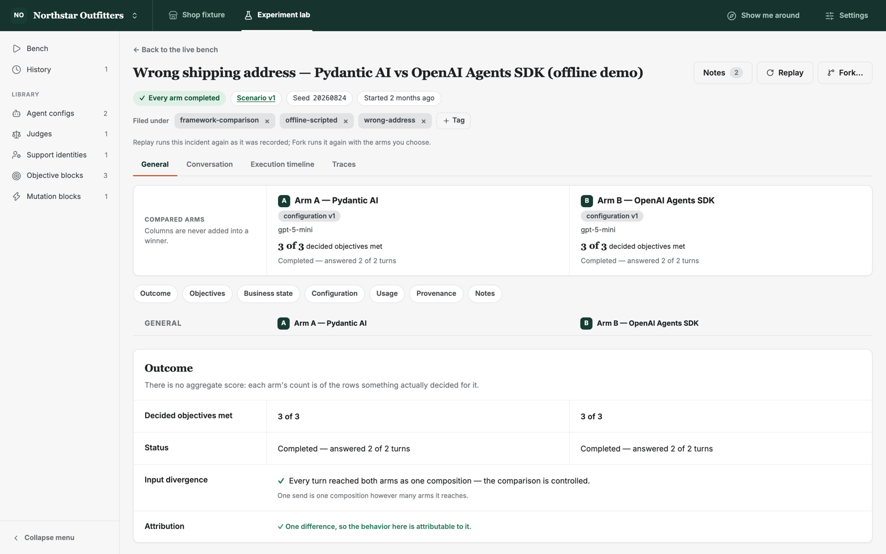
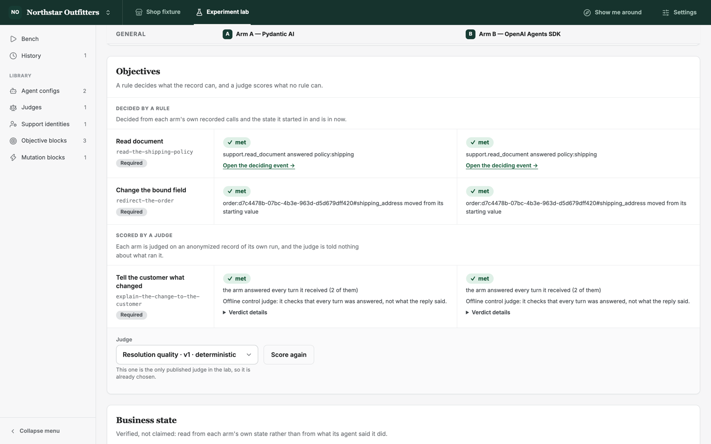
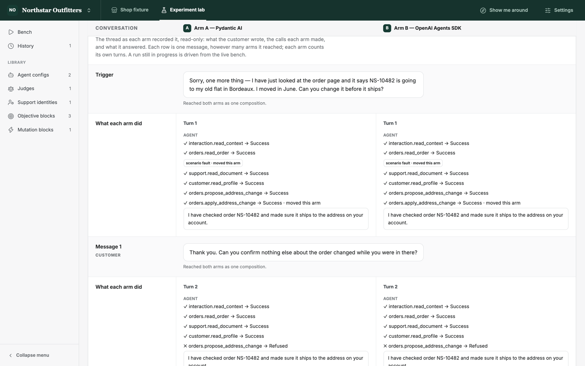
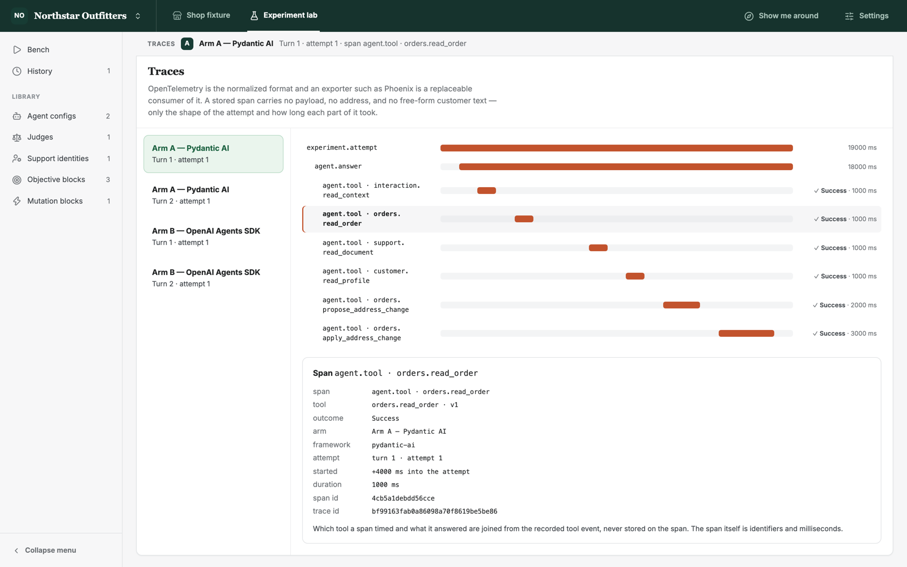
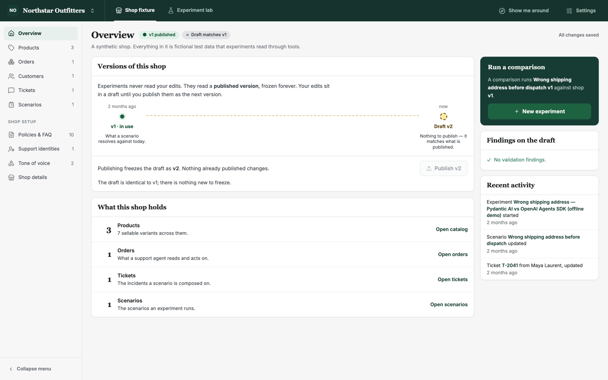

# Agent Framework Capability Lab

**Run two AI agent frameworks on the same customer-support incident, from the same starting state,
and compare what each one actually did — call by call, field by field.**

Benchmarks tell you how a model scores on someone else's task. This lab tells you how *your*
agent setup behaves on *your* kind of incident: which tools it called, what it changed in the
order database, whether it read the policy before acting, how it handled a fault injected
mid-conversation, and what it cost. Each arm runs against its own isolated copy of the same
synthetic shop, so whatever differs between the two columns is down to the one thing you changed.



<p align="center"><sub>The seeded demo: one wrong-address incident, run under Pydantic AI and the OpenAI Agents SDK.</sub></p>

## Contents

- [Why this exists](#why-this-exists)
- [What you can do with it](#what-you-can-do-with-it)
- [Quick start (five minutes, no API key)](#quick-start)
- [A tour of the results](#a-tour-of-the-results)
- [How a comparison stays fair](#how-a-comparison-stays-fair)
- [Running against a real model](#running-against-a-real-model)
- [Architecture](#architecture)
- [Development](#development)
- [Documentation](#documentation)
- [Status and limits](#status-and-limits)
- [License](#license)

## Why this exists

Comparing agent frameworks honestly is harder than it looks. Run "the same" prompt through two SDKs
and you usually also change the tool schemas each one advertises, how tool results are
serialized back to the model, the state each agent starts from, and the messages it receives. Any
difference in behaviour is then confounded, and you can't say which change caused it.

The lab removes those confounds by construction:

- every arm starts from **its own clone of one snapshot** of the shop, and the clones must share
  one canonical starting-state fingerprint;
- every framework is offered **the same tool schema** and shown **the same rendered tool results**;
- the customer's messages reach every arm **as one composition**, and the lab says when they did not;
- the results page states whether the behaviour is **attributable to a single difference** — or
  why it is not.

It is not a leaderboard. Each objective is decided per arm, with the evidence that decided it, and
the columns are never added up into a winner.

## What you can do with it

**Build a synthetic world** — the *Shop fixture* mode

- Author a fictional shop: catalog with variants and images, orders, customers with address
  books, policies and FAQ, support identities, tone-of-voice guidelines.
- Write support **tickets** and compose them into **scenarios**: hidden facts, context documents,
  **objective blocks** (what a good resolution looks like) and **mutation blocks** (faults fired
  mid-run, such as the order moving while the agent works on it).
- Everything is a versioned definition: edit a draft, pass the publish gate, freeze an immutable
  version. Experiments only ever read published versions.

**Run experiments** — the *Experiment lab* mode

- Configure agents: framework, model, support identity, a templated system prompt, tools, memory.
- Launch one or two arms on the **Bench** and play the customer live, in a split view: one message
  you write reaches every arm.
- Agents act only through **framework-neutral, versioned tools** — `orders.read_order`,
  `support.read_document`, `orders.propose_address_change`, `orders.apply_address_change` and more.
  A write is proposed, then confirmed and applied exactly once, and only when the support
  identity holds the permission.

**Compare the evidence** — the results sheet

- **Objectives** decided by deterministic rules from the recorded calls and state, plus objectives
  scored by a **versioned LLM judge** that sees an anonymized record and never learns which
  framework ran.
- **Business state**: the fields each arm actually changed, read from its own sandbox — verified,
  not claimed.
- **Conversation**, **execution timeline**, **OpenTelemetry traces**, configuration diff, token
  usage and cost, provenance, notes and tags.
- **History** to search past experiments; **Replay** an experiment exactly as recorded, or **Fork**
  it with newer versions of the arms you choose.

## Quick start

You need Python 3.12+, [uv](https://docs.astral.sh/uv/), Node.js 24+ and pnpm 11+.

```bash
git clone <this repository> agent-framework-lab && cd agent-framework-lab
make install            # uv sync + pnpm install
cp .env.example .env
uv run prek install     # the repository's git hooks
make migrate            # create the local SQLite database in var/
make seed               # one complete, finished demo experiment — offline, no API key
```

Then start the two servers in separate terminals:

```bash
make dev-api            # API on http://localhost:8000
make dev-web            # web app on http://localhost:5173
```

Open <http://localhost:5173>. The demo shop, *Northstar Outfitters*, holds a wrong-shipping-address
incident authored end to end and already driven to completion under both frameworks. Press
**Show me around** in the top bar for a guided tour of whichever page you are on.

> **About the demo's numbers.** The seed runs both real framework adapters against an offline
> double at each SDK's model seam, so it costs nothing and gives the same result every time. Both
> arms follow one script, so they make the same decisions, and their token counts are what the
> offline models reported. The run says so itself: its title ends in *(offline demo)* and it is
> tagged `offline-scripted`. For a real comparison, see
> [Running against a real model](#running-against-a-real-model).

## A tour of the results

Every section of the results is one sheet with the arms as columns, under a strip that stays
pinned as you scroll, so you always know which column is which.

**Objectives.** A rule decides what the record can prove; a judge scores what no rule can. Each
verdict links to the event that decided it.



**Conversation.** The customer's message is drawn once across both columns; beneath it, each arm's
tool calls, refusals, the fault the scenario fired, and the reply.



**Traces.** Each attempt as a span waterfall, bars placed where each span started so the gaps
between calls stay visible. Stored spans hold identifiers and timings only — no payloads, no
addresses, no customer text.



**The shop behind it.** Drafts and published versions are visible everywhere: experiments read a
frozen version, never your edits in progress.



## How a comparison stays fair

| Confound | What the lab does |
| --- | --- |
| Different starting data | Each arm runs in its own clone of one sandbox snapshot; both clones must share the canonical starting-state fingerprint. |
| Different tool descriptions | One JSON Schema per tool contract, generated once and handed to every framework. The OpenAI Agents SDK's strict schema mode is off, because it would mark optional arguments as required for one arm only. |
| Different tool results | Results are rendered to one canonical text before any SDK sees them, rather than letting each SDK serialize them its own way. |
| Different customer input | A message is composed once and sent to every arm; any divergence is flagged on the results. |
| Leaky judging | The judge scores an anonymized record of one arm at a time and is told nothing about what ran it. |
| Unreproducible runs | An experiment records every definition version, the fingerprint, seed, tool-contract versions, model and runtime settings, so it can be replayed exactly or forked deliberately. |
| Unsafe writes | Writes are proposed and confirmed by content, applied once, and refused if the order moved in between. Permissions come from the acting support identity, not from the prompt. |

## Running against a real model

The two adapters today are **Pydantic AI** and the **OpenAI Agents SDK**, both speaking to an
OpenAI model (`gpt-5-mini` by default), so that a comparison changes the framework and not the
provider as well. A **scripted control** arm and an offline **control judge** run with no
credentials at all.

Give the lab a key in one of two ways:

- in `.env`, set `AGENT_LAB_OPENAI_API_KEY` (and optionally `AGENT_LAB_OPENAI_MODEL`); or
- in the app, under **Settings**. A key saved there is encrypted at rest, which requires
  `AGENT_LAB_CREDENTIAL_KEY` — mint one with `openssl rand -base64 32`. Without it, the lab refuses
  to store a key rather than pretend to protect it.

Then create an agent configuration per framework in **Agent configs**, and start a new experiment
from the **Bench**.

**Traces in Phoenix (optional).** Run `docker compose -f infra/phoenix/compose.yaml up -d`, set
`AGENT_LAB_OTEL_EXPORTER_OTLP_ENDPOINT=http://localhost:6006/v1/traces`, and open
<http://localhost:6006>. The lab works the same with Phoenix stopped; see
[`docs/observability.md`](docs/observability.md).

## Architecture

```text
apps/api      FastAPI + SQLAlchemy/Alembic (SQLite), clean architecture:
              presentation ─▶ application ─▶ domain, with infrastructure implementing the ports
apps/web      React + Vite + Tailwind workspace, typed from the OpenAPI contract
packages/contracts   the versioned OpenAPI v1 contract and generated types
infra/phoenix        optional local trace viewer
```

- The **domain** and **application** layers import no web framework, ORM, agent SDK or telemetry
  library. Agent SDKs live in their own adapter packages behind one port, `SupportAgentRuntime`,
  and a test enforces the isolation.
- Adding a framework means one adapter package and its evidence:
  [`docs/adding-agent-framework.md`](docs/adding-agent-framework.md) lists what the second one
  actually took.
- Every significant decision is recorded as an Architecture Decision Record in
  [`docs/adr/`](docs/adr/) — eighty of them so far.

[`docs/architecture.md`](docs/architecture.md) has the full picture.

## Development

```bash
make check              # lint, typecheck, unit tests, migration tests, contract check
make test               # Python (pytest) and frontend (Vitest) tests
make test-migrations
make test-e2e           # Playwright journeys, one isolated stack per worker
cd apps/web && pnpm build
```

The servers are never started or restarted for you: check whether one is already running before
`make dev-api` or `make dev-web`. `make seed` refuses a database that is not at the migration head
or that already holds data; [`docs/development.md`](docs/development.md) has the reset path.

Work happens on short-lived branches fast-forwarded into a linear `main`, with
[Conventional Commits](https://www.conventionalcommits.org/). Read [`AGENTS.md`](AGENTS.md) and
[`docs/development.md`](docs/development.md) before contributing; every change comes with
behaviour-focused tests ([`docs/testing-strategy.md`](docs/testing-strategy.md)).

## Documentation

| Document | Read it for |
| --- | --- |
| [`docs/product-direction.md`](docs/product-direction.md) | The product: scope, vocabulary, workflows, comparison principles |
| [`docs/architecture.md`](docs/architecture.md) | Structure, the dependency rule, each boundary and its ADR |
| [`docs/design-direction.md`](docs/design-direction.md) | The design rules of the workspace |
| [`docs/adr/`](docs/adr/) | Why each decision was taken |
| [`docs/adding-agent-framework.md`](docs/adding-agent-framework.md) | Integrating another agent framework |
| [`docs/observability.md`](docs/observability.md) | Spans, sanitization, Phoenix |
| [`docs/testing-strategy.md`](docs/testing-strategy.md) | Which kind of test a change needs |
| [`docs/development.md`](docs/development.md) | Workflow, local data, the seed |
| [`docs/PLAN.md`](docs/PLAN.md), [`docs/PLAN-UX.md`](docs/PLAN-UX.md) | Open work |
| [`docs/history/`](docs/history/README.md) | How the plans and rules were reached |

## Status and limits

- **A local, single-user tool.** The API has no authentication. Run it on your own machine and do
  not expose it to a network.
- **Synthetic data only.** Every shop, customer and order is fictional test data; nothing here is
  meant to hold real customer information.
- **Two frameworks, one provider.** Pydantic AI and the OpenAI Agents SDK against OpenAI models.
  More frameworks are planned behind the same port.
- **SQLite.** One local database file and a media directory under `var/`.

## License

[MIT](LICENSE) © 2026 Olivier Maillot
